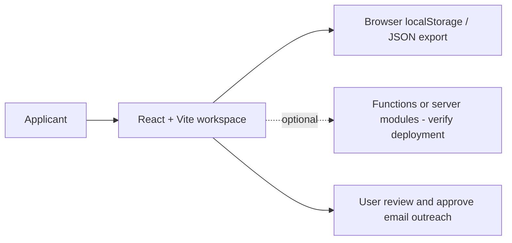

# JobPilot AI — reverse-engineered source map and KT

> **Repository:** [`bv-prasanna/job-pilot` `main`](https://github.com/bv-prasanna/job-pilot/tree/main), inspected 10 November 2026. Architecture recovered from actual file paths and existing README; **deploy status, email setup and real browser behavior remain unverified.**

## Architecture
**Scope:** React/TypeScript and browser-local job/resume workspace.

Browser-local resume and contact data are not server-authenticated and not suitable for sensitive multi-user production. The linked functions/server sources alone do not prove Gmail OAuth, background crawling, sync or outbound delivery.

## Code inventory
| Dimension | Files matched |
|---|---:|
| JS/TS source and function files | 21 |
| HTML/page entries | 2 |
| Test/spec-related source/doc files | 9 |
| Configuration/deployment source | 3 |

### User-facing pages
- [`index.html`](https://github.com/bv-prasanna/job-pilot/blob/main/index.html)
- [`src/App.tsx`](https://github.com/bv-prasanna/job-pilot/blob/main/src/App.tsx)

### Main application code and server-side handlers
- [`functions/api/job-search.js`](https://github.com/bv-prasanna/job-pilot/blob/main/functions/api/job-search.js)
- [`server/app.mjs`](https://github.com/bv-prasanna/job-pilot/blob/main/server/app.mjs)
- [`server/discovery.mjs`](https://github.com/bv-prasanna/job-pilot/blob/main/server/discovery.mjs)
- [`server/gmail.mjs`](https://github.com/bv-prasanna/job-pilot/blob/main/server/gmail.mjs)
- [`server/security.mjs`](https://github.com/bv-prasanna/job-pilot/blob/main/server/security.mjs)
- [`server/start.mjs`](https://github.com/bv-prasanna/job-pilot/blob/main/server/start.mjs)
- [`server/workflows.mjs`](https://github.com/bv-prasanna/job-pilot/blob/main/server/workflows.mjs)
- [`src/App.tsx`](https://github.com/bv-prasanna/job-pilot/blob/main/src/App.tsx)
- [`src/ErrorBoundary.tsx`](https://github.com/bv-prasanna/job-pilot/blob/main/src/ErrorBoundary.tsx)
- [`src/FindJobs.tsx`](https://github.com/bv-prasanna/job-pilot/blob/main/src/FindJobs.tsx)
- [`src/QuickApply.tsx`](https://github.com/bv-prasanna/job-pilot/blob/main/src/QuickApply.tsx)
- [`src/ResumeManagement.tsx`](https://github.com/bv-prasanna/job-pilot/blob/main/src/ResumeManagement.tsx)
- [`src/lib/core.mjs`](https://github.com/bv-prasanna/job-pilot/blob/main/src/lib/core.mjs)
- [`src/lib/indiaEligibility.mjs`](https://github.com/bv-prasanna/job-pilot/blob/main/src/lib/indiaEligibility.mjs)
- [`src/lib/model.ts`](https://github.com/bv-prasanna/job-pilot/blob/main/src/lib/model.ts)
- [`src/lib/quickApply.mjs`](https://github.com/bv-prasanna/job-pilot/blob/main/src/lib/quickApply.mjs)
- [`src/lib/resume.ts`](https://github.com/bv-prasanna/job-pilot/blob/main/src/lib/resume.ts)
- [`src/lib/resumeStore.ts`](https://github.com/bv-prasanna/job-pilot/blob/main/src/lib/resumeStore.ts)
- [`src/lib/titleRelevance.mjs`](https://github.com/bv-prasanna/job-pilot/blob/main/src/lib/titleRelevance.mjs)
- [`src/main.tsx`](https://github.com/bv-prasanna/job-pilot/blob/main/src/main.tsx)
- [`src/vite-env.d.ts`](https://github.com/bv-prasanna/job-pilot/blob/main/src/vite-env.d.ts)

### Configuration, tests and deployment artifacts
- [`functions/api/job-search.js`](https://github.com/bv-prasanna/job-pilot/blob/main/functions/api/job-search.js)
- [`package.json`](https://github.com/bv-prasanna/job-pilot/blob/main/package.json)
- [`vite.config.ts`](https://github.com/bv-prasanna/job-pilot/blob/main/vite.config.ts)
- [`tests/api.test.mjs`](https://github.com/bv-prasanna/job-pilot/blob/main/tests/api.test.mjs)
- [`tests/core.test.mjs`](https://github.com/bv-prasanna/job-pilot/blob/main/tests/core.test.mjs)
- [`tests/discovery.test.mjs`](https://github.com/bv-prasanna/job-pilot/blob/main/tests/discovery.test.mjs)
- [`tests/gmail.test.mjs`](https://github.com/bv-prasanna/job-pilot/blob/main/tests/gmail.test.mjs)
- [`tests/india-eligibility.test.mjs`](https://github.com/bv-prasanna/job-pilot/blob/main/tests/india-eligibility.test.mjs)
- [`tests/job-search.test.mjs`](https://github.com/bv-prasanna/job-pilot/blob/main/tests/job-search.test.mjs)
- [`tests/quick-apply.test.mjs`](https://github.com/bv-prasanna/job-pilot/blob/main/tests/quick-apply.test.mjs)
- [`tests/title-relevance.test.mjs`](https://github.com/bv-prasanna/job-pilot/blob/main/tests/title-relevance.test.mjs)
- [`tests/workflows.test.mjs`](https://github.com/bv-prasanna/job-pilot/blob/main/tests/workflows.test.mjs)

## Data storage and migration applicability
**No committed versioned relational schema migration was identified in `main`.** Do not fabricate PostgreSQL tables or migration scripts for this site. React screens and local persistence, job-source adapters and any Cloudflare Functions/server handlers should be tested separately.
Periodically export the browser-local JSON backup; treat import/export as a migration/restore process for browser-local state, and verify consent/retention for resumes and HR contacts.
[Earlier architecture, deployment, database applicability and KT guide](README.md).

## Source-to-operations validation checklist
1. Enumerate actual public URLs/HTML routes, browser viewport/accessibility and client-side state with smoke tests.
2. Trace contact or job interaction to the exact handler (if used). Verify status codes, validation, network timeout, spam controls and **user-friendly** errors.
3. Ensure no secrets in HTML/client bundles, test safe HTTP headers, CSRF/origin policy, rate limiting and privacy handling.
4. Pin approved commit, create verified production build, deploy staging and test external service deliveries using test data.
5. Document real DNS, Cloudflare/hosting account, env vars **without values**, delivery service setup, logs, alert owner and rollback deployment.
6. Sign off UAT in desktop/mobile browser; negative tests include broken links, invalid forms, unavailable email provider, oversized file uploads if enabled, cross-origin access, storage loss, missing permission and accessibility.

## KT demo
Walk through key screens; describe architecture and trust boundaries; demonstrate test enquiry or local export, expected friendly errors, deployment/build commands, smoke tests, monitoring and recovery. Confirm owners and escalation contacts. **Do not claim live delivery or synchronisation unless a real test confirms it.**

## Source correction — current resume, search and Gmail workflows (10 Nov 2026)

The older repository README describes a text-only, mailto-based MVP. **Current `main` has additional code; its concrete modules take precedence over that historical description.**

| Capability now represented in source | Evidence | Verification still needed |
|---|---|---|
| Resume versions/selection | [Resume Management](../../src/ResumeManagement.tsx), [resume storage](../../src/lib/resumeStore.ts) | Browser persistence, account switch, large-file and default attachment behavior |
| PDF/DOCX/TXT/MD import | [browser-side extractor](../../src/lib/resume.ts) using `pdfjs-dist` and `mammoth` | Scanned PDFs without text, parsing limits, no upload to server |
| Public remote jobs | [Pages Function](../../functions/api/job-search.js) queries public ATS/job feeds, filters India eligibility and title relevance | Real deployed endpoint, quotas, source reliability and accurate India-based eligibility |
| Alternative local server API | [server app](../../server/app.mjs), [discovery](../../server/discovery.mjs), [start](../../server/start.mjs) | Persistence and authentication, whether deployed and authorised |
| Gmail user-approved send | [Quick Apply](../../src/QuickApply.tsx), [Gmail setup](../../docs/QUICK-APPLY.md) | User consent, OAuth client/origin, sent-message receipt, attachment and token expiry |

**Important:** Gmail send and public job discovery are code capabilities with external prerequisites, not evidence that Gmail OAuth or cloud functions are configured in the live site. Quick Apply requires explicit user review/authorization; credentials are not to be persisted in browser storage. Do not claim automatic recruiter outreach or guaranteed ATS scoring.

**KT negative tests:** invalid recipient, unsupported/scanned PDF, expired OAuth permission, missing attachment, Gmail provider error, empty/mismatched public ATS feed, US-only role incorrectly shown to India applicants, duplicate resume and browser storage loss.
